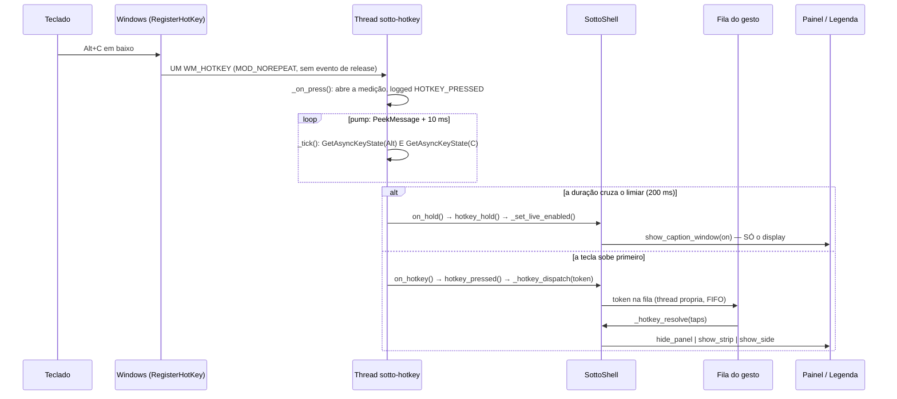

# O Alt+C de ponta a ponta — a auditoria completa (ordem do dono, 2026-10-30 09:33)

> Ele, verbatim: *"faz full audit. tu vai me explicar exatamente a logica inteira,
> sem sobrar nada, sem faltar caminho, de como o alt c funciona e tudo que ele faz
> e a prioridade de cada alt c e como funciona e etc. e tu vai me falar se tem
> algum erro."*
>
> Este documento é essa explicação, escrita contra o **código de hoje**
> (`app/webview/sotto_webview.py`, `app/webview/hotkey_gesture.py`,
> `app/webview/hotkey_settings.py`). Onde há erro, está na última secção, com o
> número que o mede.

## 1. O caminho inteiro, do teclado ao ecrã



Os saltos, um a um, com o sítio no código:

| # | passo | código | facto que o define |
|---|---|---|---|
| 1 | registo | `HotkeyThread.run` → `RegisterHotKey(None, _HOTKEY_ID, mods\|MOD_NOREPEAT, vk)` | a tecla é da **thread**, não de uma janela: funciona sem janela nenhuma do Sotto existir ou ter foco |
| 2 | entrega | o sistema põe `WM_HOTKEY` na fila dessa thread | com `MOD_NOREPEAT` chega **um** evento por pressão e **nenhum** de libertação |
| 3 | pump | `PeekMessageW(..., PM_REMOVE)` + `sleep(0.01)` | `GetMessageW` bloqueante nunca veria a tecla subir, e sem isso a duração não existe |
| 4 | abertura | `_on_press()` | se havia medição aberta, fecha-a como **toque** (`reason=new-press`) antes de abrir a nova |
| 5 | medição | `_tick()` | lê as **duas** teclas: o gesto acaba quando **qualquer** delas sobe |
| 6 | HOLD | `_deliver_hold()` → `on_hold` → `SottoShell.hotkey_hold` | entregue **ao cruzar o limiar**, com a tecla em baixo — não no release |
| 7 | TOQUE | `_finish_measure()` → `on_hotkey` → `hotkey_pressed` | só quando a tecla subiu **antes** do limiar (ou o limite de 5 s) |
| 8 | contagem | `hotkey_pressed`: janela `HOTKEY_TAP_WINDOW_MS = 400` | dois toques dentro da janela somam; um `Timer` esquece a contagem quando ela fecha |
| 9 | despacho | `_hotkey_dispatch` → fila → `_hotkey_worker_loop` | a acção **não** corre na thread do hotkey: trabalho de janela ali bloquearia o próximo Alt+C |
| 10 | decisão | `_hotkey_resolve` → `hotkey_gesture.resolve_taps` + `surface_applied` | 1 toque = faixa de baixo; 2 = painel da direita; o **mesmo** painel outra vez = fecha |

## 2. A prioridade de cada gesto (a pergunta dele)

A ordem em que o código decide, e porque é essa:

1. **HOLD ganha ao TOQUE da MESMA pressão.** `_deliver_hold` marca `_hold_fired`
   **antes** de chamar o shell: se o handler explodir, o release não cai no ramo
   do toque. Um Alt+C nunca é legenda **e** painel.
2. **O TOQUE ganha quando o limiar NÃO foi visto pelo tick.** Se a tecla subiu
   entre duas voltas do pump e a medição atravessou o limiar sem que ninguém o
   visse, o release entrega um **toque** e escreve `HOTKEY_SWALLOWED_HOLD` no
   log. Um HOLD perdido é um dano pequeno; um HOLD **inventado** é a acção
   errada na cara dele.
3. **O TECTO ganha a tudo aos 5000 ms** (`HOLD_CEILING_MS`): uma tecla presa (ou
   um `GetAsyncKeyState` que nunca baixa) não deixa a medição aberta para sempre.
4. **O painel que está no ecrã ganha ao alvo do gesto.** `_hotkey_resolve` lê
   `surface_applied` (o que a **janela veste**, não uma intenção): pedir o mesmo
   painel **fecha**; pedir o outro **troca**. Um `show` que falhou deixou o
   painel escondido, e fechar o que já está fechado seria um `PANEL_HIDDEN` a
   mentir no log.
5. **A ORDEM DOS TOQUES é FIFO.** A fila serializa: dois toques seguidos não se
   atropelam, e o segundo vê a contagem que o primeiro deixou.
6. **A LEGENDA é ortogonal aos painéis.** `hotkey_hold` → `_set_live_enabled` →
   `show_caption_window(on)` e **mais nada**: não descarrega motor, não reinicia
   worker, não toca no histórico, não fecha painel (ordem de 2026-10-19:
   *"clicar pra ligar a legenda pelo painel do alt c nao deve fechar o painel"*).

## 3. Os números, e quem manda em cada um

| número | valor | onde vive | quem pode mudar |
|---|---|---|---|
| limiar do HOLD | **200 ms** (ordem directa dele, 2026-10-30) | `hotkey_gesture.HOTKEY_HOLD_MS` | ele, no painel da direita → `_main/hotkey-settings.json` (`holdMs`), escolhas `200 300 400 500 700 900 1200` |
| janela de toques | 400 ms | `hotkey_gesture.HOTKEY_TAP_WINDOW_MS` | ninguém (é o que separa toque de toque duplo) |
| tecto da medição | 5000 ms | `hotkey_gesture.HOLD_CEILING_MS` | ninguém |
| sondagem do pump | 10 ms | `HotkeyThread.run` | ninguém (é o custo por volta) |

O shell **não** tem uma segunda cópia destes números: lê-os por
`hotkey_numbers()`. Um número, um sítio — foi o defeito #9 da tabela do recibo
(*"varias implementacoes diferentes e tao conflitando entre si?"*).

## 4. Os erros que eram erros, e o que os mediu

| o que estava errado | a medição que o provou | onde está a correcção |
|---|---|---|
| o contrato contava **pressões** dentro de uma janela (1 toque = legenda) | 163 rajadas no log dele: 73 eram um Alt+C **segurado**, e um toque isolado nunca mostrava painel | `hotkey_gesture.resolve_taps` por **toques** + `_hotkey_resolve` |
| limiar 500 ms **dentro** dos toques dele | 21 pressões: 531 / 578 / 641 ms viravam HOLD quando ele queria o painel | hoje 200 ms por ordem dele; o custo está no §5 |
| a medição **bloqueava** a thread do hotkey | com a tecla em baixo, nenhum `WM_HOTKEY` novo era entregue | `_tick` no pump, sem `while`, e a acção numa fila própria |
| lia-se só o **Alt** | ele larga o `C` e o Alt fica em baixo um instante → um toque saía como HOLD | `_alt_is_down` exige as **duas** teclas |
| o primeiro painel esperava 400 ms | pressão → `PANEL_SHOWN` = 460 ms, dos quais 8 ms de trabalho real | o 1.º toque mostra no instante; a janela só **promove** |
| Alt+C de novo **não fechava** o painel | *"POR QUE APERTAR ALT C DE NOVO NAO FECHA O PAINEL ATUAL?"* | `surface_applied` + `hide_panel('hotkey-toggle')` |
| três implementações do gesto a discordar | *"varias implementacoes diferentes e tao conflitando entre si?"* | `hotkey_gesture` é a única; o shell lê por `hotkey_numbers()` |

## 5. OS ERROS QUE CONTINUAM — e o número de cada um

Nenhum destes está escondido no código; cada um é uma consequência conhecida.

1. **Com 200 ms, os toques lentos dele viram HOLD.** As pressões medidas de
   204, 438, 468, 531, 578 e 641 ms passam o limiar: cada uma comuta a legenda em
   vez de mostrar o painel. Isto é a **ordem dele** (*"a porra do alt c, bota
   200ms"*), não uma interpretação minha; o dropdown do painel da direita tem
   200/300/400/500/700/900/1200 para ele voltar atrás num clique.
2. **Um release perdido vira toque, não HOLD.** Se a tecla subir entre duas
   voltas do pump e a medição tiver atravessado o limiar, o log diz
   `HOTKEY_SWALLOWED_HOLD` e o que sai é um toque. O HOLD só existe quando o
   tick o viu.
3. **A janela de 400 ms é mais curta que um toque duplo lento.** Dois toques com
   500 ms de intervalo são dois toques **simples**: abre a faixa e fecha-a. É o
   preço de mostrar o primeiro painel no instante; a alternativa era os 400 ms
   de nada que ele reclamou.
4. **Nada disto foi medido no teclado dele por esta lane.** Input sintético mede
   o Windows, não a app (`AGENTS.md`, medido em 2026-10-23: quatro `err=0` do
   pressionador e **zero** linhas no log do Sotto). O que existe é o seam
   `fake_hold_ms` (o oráculo injecta a duração) e o log vivo `HOTKEY_PRESSED` /
   `HOTKEY_RELEASED` / `HOTKEY_HOLD_FIRED`, que é onde a mão dele já foi lida.
5. **O limiar escolhido não sobrescreve a tabela de 21 pressões.** Se ele mudar
   o dropdown para 900, o comportamento volta ao de antes do 200 ms — e é isso
   que o dropdown significa. Não há reconciliação automática entre a escolha
   dele e as pressões medidas: a escolha é dele.

## 6. Verificação por instrumento

```
python _main/altc-gesture-oracle.py            -> ALTC-GESTURE GREEN -- arms=90 pass=90 fail=0
python _main/altc-gesture-oracle.py --neg-arm  -> NEG-ARM PASS
```

Os braços que interessam a esta auditoria: a fronteira (199 ms = toque, 200 ms =
HOLD), o toque mais lento **medido** dele (641 ms) a cair acima do limiar
escolhido, o disparo do HOLD no tick e não no release, `_on_press`/`_tick` sem
`while`/`for` (não bloqueiam), `_set_live_enabled` **sem** nomear worker,
histórico, `_pause_shell`, `hide_panel` ou `show_panel`, e o shell a ler os
números por `hotkey_numbers()` em vez de os redefinir.

Passos da bateria: `altc-gesture` + `red-as-expected-altc-gesture` (ambos
`always`), e `altc-first-caption` + `red-as-expected-altc-first-caption`.

**`verified` não se escreve aqui.** O que existe é *implementado e medido na
camada abaixo do ecrã*: nenhum frame do ecrã dele, nenhuma tecla sintética.
