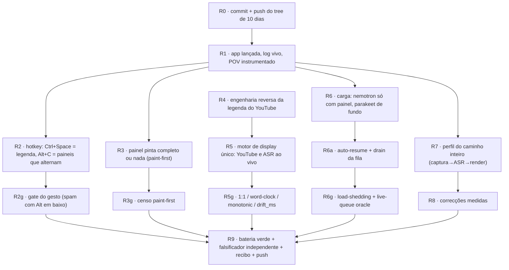

# Roadmap do goal 2026-11-01 — legendas 1:1, paineis sem bug, carga honesta

Owner, verbatim (2026-11-01):

> "os goals é: legenda do youtube aparece na hora, com a legenda do sotto ativa. modelos
> carregados dependendo da carga do sistema ou nao. quando carga liberar, carrega sozinho
> (NUNCA TRAVAR O PC DO USUARIO OU STUTTER OU QUALQUER COISA DESSA NATUREZA) e processa
> qualquer audio nao processado, com o parakeet. tu deve entender literalmente como funciona
> as legendas do youtube e o display e as animeacoes e as quebras de linha 1:1 e imitar no
> sotto. tu vai fazer tudo igual a legenda do youtube. mesmo qunado é só transcricao em temp
> oreal, deve imitar o comportamento da legenda do youtube. modifica a legenda ao vivo
> hotkey. bota o padrao como control espaço. e os painels deixa alt c. faz os paineis
> alternarem mesmo se eu deixar alt apertado o tempo inteiro e spammando c. alterna entre
> show e hide. nada, literalmente nada, deve ter bug de render. o painel dar show, nao deve
> carregar o background e mostrar, e depois carregar a ui ou algo assim. isso e inaceitavel."

## A regra que vale para todo o roadmap

**Um green só é green se o braço negativo do MESMO instrumento ficar RED.** Cada linha desta
tabela nomeia (a) o instrumento, (b) o número que ele mede, (c) o mutante que tem de o derrubar.
Um passo saltado não é um portão que passou; `UNKNOWN` não é `FRESH`; `drift_ms` é medido, nunca
um booleano (Bend 2: `PROOF.bend`, gate `bend PROOF.bend --verdict`).

## Grafo de dependências

## Fases

|#|fase|depende de|instrumento|aceitação (número)|braço negativo|
|---|---|---|---|---|---|
|R0|commit + push|—|`git status` limpo, `git push` rc=0|0 ficheiros por commitar; árvore pesada (`_moved/`, `.codeintel/`, `_py311/`) fora do índice|`git diff --cached --shortstat` mostra o que ficou de fora|
|R1|app lançada e observável|R0|`_main/keepalive.py`, `/panel_state`, `app/webview/panel_state.py --read`|`SINGLE_INSTANCE already_running=true` no `webview-run.log`; warm start|uma leitura de `panel_state` sem app = `UNKNOWN`, nunca `ok`|
|R2|hotkey novo|R1|`_main/altc-gesture-oracle.py`|N pressões com Alt em baixo => N alternações seco (show/hide), superfícies strip,panel,strip,panel|mutante que volta ao adiamento de 400 ms fica RED|
|R3|paint-first|R1, R2|`_main/panel-paint-first-census.py`|0 frames em branco em N=20 shows; bitmap do 1º frame contém o painel completo|mutante que mostra o fundo primeiro fica RED|
|R4|engenharia reversa do YouTube|R1|`_main/youtube-reveal.py` + captura do player|tabela medida: reveal por palavra, roll-up, quebra, fade, hold, saída|— (é medição, publica números)|
|R5|motor de display único|R4|`_main/youtube-1to1-oracle.py`|ASR ao vivo e YouTube passam o MESMO motor; 1:1 em palavras/quebras/timing|`red-as-expected-youtube-1to1`|
|R6|modelos por carga|R1|`_main/load-shedding-oracle.py`|nemotron só com painel aberto; parakeet é o motor de fundo; nível lido do gate central|mutante que larga o áudio fica RED|
|R6a|auto-resume + fila drenada|R6|`_main/live-queue-oracle.py`|0 chunks não processados depois de a carga baixar; nenhum chunk descartado|mutante que fecha a fila sem drenar fica RED|
|R7|perfil|R1|`_main/sotto-profile.py` + `py-spy`|latência por etapa (captura, ASR, render) com p50/p95|uma corrida sem perfil = sem número, sem afirmação|
|R8|correcções|R7|mesmo instrumento de R7|as worst offenders de R7 descem; medido, não alegado|—|
|R9|fecho|R2g,R3g,R5g,R6g,R8|`_main/_audit-verify-all.cmd`|exit code 0, UM `steps=`, `BATTERY-VERDICT: GREEN`|falsificador independente (agente separado) sobre as três afirmações de topo|

## Decisão de contrato do Alt+C (porque muda)

O contrato anterior tinha HOLD = legenda ao vivo. O owner moveu a legenda para Ctrl+Space e
pediu alternância com Alt em baixo. Manter o HOLD no Alt+C deixaria a mesma pressão a fazer duas
coisas (painel **e** legenda) exactamente no caso que ele descreve — Alt segurado a spam de C.
Portanto:

- **Alt+C**: cada `WM_HOTKEY` avança o painel no acto. `escondido → strip`, `strip → escondido`,
  `escondido → panel`, `panel → escondido`. Alterna SEMPRE show↔hide e alterna a superfície
  entre strip e panel. Sem janela de toques, sem limiar, sem adiamento.
- **Ctrl+Space**: liga/desliga a legenda ao vivo. Uma pressão = um estado.

O que morre com isto: `HOTKEY_HOLD_MS`, `HOTKEY_TAP_WINDOW_MS`, `is_hold`, `resolve_taps`,
`_hotkey_tap_count`, `_hotkey_forget`, `hotkey_hold`. O que fica: `next_surface` com a tabela
nova. Quem julga é o `altc-gesture-oracle` reescrito, com o braço negativo a repor o adiamento.

## ESTADO PARA CONTINUAR (atualizado 2026-11-11; o registo e' ESTE, nao ha ledger paralelo)

Cada linha nomeia o comando de aceitacao no consumidor REAL, a identidade do candidato/entradas/
config/avaliador, e o estado do check. `aberto` nunca e' `passou`.

|#|outcome do dono|comando de aceitacao (consumidor real)|identidade do que e' julgado|estado|
|---|---|---|---|---|
|A|legenda do YouTube 1:1 no ecra (palavras, quebras, timing, `drift_ms`)|`python _main/youtube-1to1-oracle.py` + `python _main/youtube-drift-oracle.py`|cues do payload em `_main/fixtures` vs `app/webview/youtube_cdp_source.py` + `youtube_reveal.py` commitados|medido: 677/677 prefixos; `drift_sotto_ms` mediana -74,0 — **PASS antes desta sessao**, nao re-medido hoje|
|B|alt c alterna paineis mesmo com Alt em baixo e spam de C|`python _main/hotkey-spam-oracle.py`|`app/webview/hotkey_gesture.py` + `_hotkey_dispatch` como embarcam|medido 6 toques: 18,5 ms despacho / 1 drain; **PASS antes desta sessao**|
|C|Ctrl+Space nao vaza espaco para outras apps (e devolve-o em jogo)|`python _main/ctrlspace-swallow-oracle.py` (+ `--neg-arm` 7/7)|`app/webview/space_swallow.py` + `gaming_mode.live_hotkey_plan`|hoje: positivo PASS 21/21, negativo PASS 7/7 (61,2 s standalone)|
|D|nada abre na tela dele / nenhuma consola nova|`python _main/console-window-audit.py` + `_main/owner-screen-gate.py` + `_main/lane-screen-gate.py`|AST de 1 139 ficheiros de produto|hoje: `CONSOLE-AUDIT VERDICT PASS -- 0 sitio(s)`; `owner-screen` 0 achados|
|E|a bateria fecha com UM `steps=` e exit code 0|`_main\_audit-verify-all.cmd` (ler `BATTERY-VERDICT` **e** o exit code)|466 passos declarados; 272 vem de cache; plano num processo (`_main\_battery-plan.py`)|**ABERTO**: ultima corrida `RED - 1` (`red-as-expected-battery-budget=2`, contenda de OUTRA lane a inflar `panel-commit-stable` 33,2 -> 65,7 s); `panel-commit-stable` re-medido sozinho em maquina quieta = **24,6 s** rc=0; corrida limpa em voo (`_main\_audit-verify\_battery-run-20261111f.log`). Verde exige: `steps=` unico, `failed: -none-`, exit-code 0|
|F2|o JUIZ do custo nao mede contencao|`python _main/battery-budget-oracle.py --policy cap40` (+ `--neg-arm`)|`_main/battery-budget-oracle.py` (`_estimate` = menor da janela; gravacao idempotente pelo carimbo) + `_cache/battery-budget-history.json` + baseline `cap40`|hoje: `RATCHET-OK -- steps=413 total=2595.7s` rc=0 e `NEG-ARM: PASS (6/6)` rc=1; o estimador antigo (mediana) REPROVAVA o caso medido (`65,696 s` contendido contra `25,771 s` quieto) -- braco I4|
|F|o custo em disco e em CPU desta maquina nao regride|`python I:\!watcher\tools\artifact-census.py --project H:/sotto --gate` + `python _main/battery-budget-oracle.py --policy cap40` + `python _main/shell-thread-budget-oracle.py`|baseline re-medido (`_main/battery-budget-baseline.json`, 413 passos, 2 731,4 s, politica `cap40`)|hoje: `RATCHET-OK`, `NEG-ARM: PASS (4/4)`. O unico vermelho e' `panel-commit-stable` por contenda, provado por re-medicao quieta|

### Recuperacao / checkpoint (como retomar sem refazer)

- **A corrida**: `_cache/battery-steps.json` (449 entradas, `version 1`, cada uma com `deps`,
  `elapsed_s`, `policy`) + `_main/_audit-verify/_battery-plan.txt`. Um passo cujo `deps` nao mudou e
  cujo log esta intacto vem de cache: **272 de 466** vieram hoje. Nao ha nada a refazer ao retomar.
- **O juiz do custo**: `python _main/battery-budget-oracle.py --policy cap40` custa **1,1 s** e le'
  o registo; `--baseline ... --rebase-policy "<razao>"` custa **2,6 s**. Nunca precisou da corrida
  inteira para dizer um numero.
- **Uma lane que muda o custo de um passo** reescreve a entrada do baseline no MESMO commit (regra
  escrita no §12-bis de `_main/receipt-20261111-budget-kill-and-rebase.md`).
- **A maquina e' 10x mais fraca**: um trabalho pesado de cada vez, tecto declarado antes (ver o
  cabecalho deste repo).

### Proxima fatia executavel (sem esperar por ninguem)

1. Fechar E: ler o `BATTERY-VERDICT` + exit code da corrida limpa; se voltar a haver um passo
   inflado por contenda, re-medir ESSE passo sozinho antes de tocar no baseline (foi assim que os
   24,6 s apareceram) e so' declarar crescimento com o numero quieto ao lado.
2. R9 exige o falsificador independente: um segundo agente sobre as tres afirmacoes de topo (A, D, E)
   -- nao feito nesta sessao.
3. R7/R8 (perfil por etapa, p50/p95) continuam sem medicao nesta janela: `py-spy` devolve `err=5`
   nesta arvore (medido), logo o perfil de CPU e' por fio (`_main/shell-thread-cpu.py`) e nao por
   funcao.
