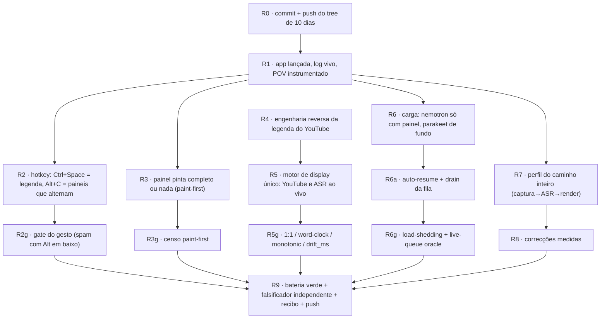

# Roadmap do goal 2026-11-01 — legendas 1:1, paineis sem bug, carga honesta

Owner, verbatim (2026-11-01):

> "os goals é: legenda do youtube aparece na hora, com a legenda do sotto ativa. modelos
> carregados dependendo da carga do sistema ou nao. quando carga liberar, carrega sozinho
> (NUNCA TRAVAR O PC DO USUARIO OU STUTTER OU QUALQUER COISA DESSA NATUREZA) e processa
> qualquer audio nao processado, com o parakeet. tu deve entender literalmente como funciona
> as legendas do youtube e o display e as animeacoes e as quebras de linha 1:1 e imitar no
> sotto. tu vai fazer tudo igual a legenda do youtube. mesmo qunado é só transcricao em temp
> oreal, deve imitar o comportamento da legenda do youtube. modifica a legenda ao vivo
> hotkey. bota o padrao como control espaço. e os painels deixa alt c. faz os paineis
> alternarem mesmo se eu deixar alt apertado o tempo inteiro e spammando c. alterna entre
> show e hide. nada, literalmente nada, deve ter bug de render. o painel dar show, nao deve
> carregar o background e mostrar, e depois carregar a ui ou algo assim. isso e inaceitavel."

## A regra que vale para todo o roadmap

**Um green só é green se o braço negativo do MESMO instrumento ficar RED.** Cada linha desta
tabela nomeia (a) o instrumento, (b) o número que ele mede, (c) o mutante que tem de o derrubar.
Um passo saltado não é um portão que passou; `UNKNOWN` não é `FRESH`; `drift_ms` é medido, nunca
um booleano (Bend 2: `PROOF.bend`, gate `bend PROOF.bend --verdict`).

## Grafo de dependências

## Fases

|#|fase|depende de|instrumento|aceitação (número)|braço negativo|
|---|---|---|---|---|---|
|R0|commit + push|—|`git status` limpo, `git push` rc=0|0 ficheiros por commitar; árvore pesada (`_moved/`, `.codeintel/`, `_py311/`) fora do índice|`git diff --cached --shortstat` mostra o que ficou de fora|
|R1|app lançada e observável|R0|`_main/keepalive.py`, `/panel_state`, `app/webview/panel_state.py --read`|`SINGLE_INSTANCE already_running=true` no `webview-run.log`; warm start|uma leitura de `panel_state` sem app = `UNKNOWN`, nunca `ok`|
|R2|hotkey novo|R1|`_main/altc-gesture-oracle.py`|N pressões com Alt em baixo => N alternações seco (show/hide), superfícies strip,panel,strip,panel|mutante que volta ao adiamento de 400 ms fica RED|
|R3|paint-first|R1, R2|`_main/panel-paint-first-census.py`|0 frames em branco em N=20 shows; bitmap do 1º frame contém o painel completo|mutante que mostra o fundo primeiro fica RED|
|R4|engenharia reversa do YouTube|R1|`_main/youtube-reveal.py` + captura do player|tabela medida: reveal por palavra, roll-up, quebra, fade, hold, saída|— (é medição, publica números)|
|R5|motor de display único|R4|`_main/youtube-1to1-oracle.py`|ASR ao vivo e YouTube passam o MESMO motor; 1:1 em palavras/quebras/timing|`red-as-expected-youtube-1to1`|
|R6|modelos por carga|R1|`_main/load-shedding-oracle.py`|nemotron só com painel aberto; parakeet é o motor de fundo; nível lido do gate central|mutante que larga o áudio fica RED|
|R6a|auto-resume + fila drenada|R6|`_main/live-queue-oracle.py`|0 chunks não processados depois de a carga baixar; nenhum chunk descartado|mutante que fecha a fila sem drenar fica RED|
|R7|perfil|R1|`_main/sotto-profile.py` + `py-spy`|latência por etapa (captura, ASR, render) com p50/p95|uma corrida sem perfil = sem número, sem afirmação|
|R8|correcções|R7|mesmo instrumento de R7|as worst offenders de R7 descem; medido, não alegado|—|
|R9|fecho|R2g,R3g,R5g,R6g,R8|`_main/_audit-verify-all.cmd`|exit code 0, UM `steps=`, `BATTERY-VERDICT: GREEN`|falsificador independente (agente separado) sobre as três afirmações de topo|

## Decisão de contrato do Alt+C (porque muda)

O contrato anterior tinha HOLD = legenda ao vivo. O owner moveu a legenda para Ctrl+Space e
pediu alternância com Alt em baixo. Manter o HOLD no Alt+C deixaria a mesma pressão a fazer duas
coisas (painel **e** legenda) exactamente no caso que ele descreve — Alt segurado a spam de C.
Portanto:

- **Alt+C**: cada `WM_HOTKEY` avança o painel no acto. `escondido → strip`, `strip → escondido`,
  `escondido → panel`, `panel → escondido`. Alterna SEMPRE show↔hide e alterna a superfície
  entre strip e panel. Sem janela de toques, sem limiar, sem adiamento.
- **Ctrl+Space**: liga/desliga a legenda ao vivo. Uma pressão = um estado.

O que morre com isto: `HOTKEY_HOLD_MS`, `HOTKEY_TAP_WINDOW_MS`, `is_hold`, `resolve_taps`,
`_hotkey_tap_count`, `_hotkey_forget`, `hotkey_hold`. O que fica: `next_surface` com a tabela
nova. Quem julga é o `altc-gesture-oracle` reescrito, com o braço negativo a repor o adiamento.
