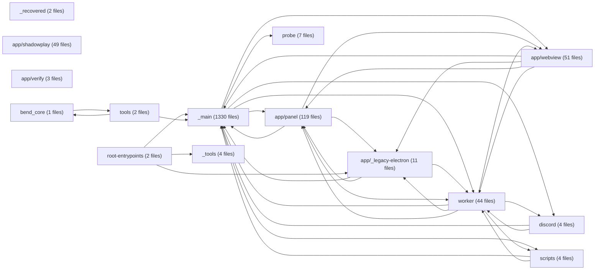

# Macro Feature Architecture — sotto

> Auto-synced from Git (`61802bc`) at `2026-11-27T07:04:20Z` by `feature_map_sync.py`.
> Refine `how_it_works`, `inputs`, `outputs`, `interlinks`, `verify_cmd`, and `metric_ids` in `features/features.json` (set `"curated": true`) — re-syncs preserve curated contracts while keeping file lists & commits live.

## 1. Macro Feature Matrix

| Feature | Files | Commits | Inputs | Outputs | Interlinks | How It Works |
|---|---:|---:|---|---|---|---|
| `_main` | 1330 | 349 | Tracked source tree under `_main/`, `app/` and `worker/`; Battery step timings in `_cache/battery-steps.json` and `_main/battery-budget-baseline.json`; Oracle flags such as `--neg-arm` and `--record-step` | Per-oracle PASS/FAIL verdicts and rc on stdout; Step logs under `_main/_audit-verify/`; Ratchet updates in `_main/tooling-intent-baseline.json` | app/panel, app/webview, worker, discord | _main is the verification workshop rather than shipped runtime: `_main/_audit-verify-all.cmd` runs the aggregated battery and records each s |
| `_recovered` | 2 | 0 | Frozen Python snapshots committed during the 2026-10-23 recovery; Diff receipts in `_main/RECOVERY.md` and `_main/INTEGRATION-11.md` | Reconstructable diff between pre-loss HEAD and recovered worker; No runtime JSONL and no app state | - | `_recovered/worker_fab495ac.py` is the 4593-line snapshot recovered from the checkout that destroyed worker edits; `_recovered/worker_186c96 |
| `_tools` | 4 | 0 | Read-only URI to C:/Users/Administrador/.minimax/v2/sqlite/runtime-state.sqlite; UTC cutoff and MAX timestamps from `_main/CRON-TRUTH.md` | POPULATION/WINDOW counts and pass-by-pass verdicts on stdout; Cron-silence evidence cited in `_main/CRON-VERDICT.md` | - | All four files are read-only SQLite passes over the same agent runtime store: `_tools/cron-restore-probe.py` counts rows after the 13:11Z cu |
| `app/_legacy-electron` | 11 | 1 | Child-process stdout JSONL (captions and statuses); Renderer IPC messages such as hide, toggle, pointer and getInfo | Captions and statuses delivered to the panel receiver and main-process caption log; Bridge-selftest rc 0/3 with per-step receipts | _main, app/panel, worker | `app/_legacy-electron/main.js` is the retired Electron main process and says so explicitly: the live window is the pywebview shell in `app/w |
| `app/panel` | 119 | 25 | `window.sotto` bridge events and worker caption lines relayed by the shell; Local theme CSS and bundled woff2 fonts; History root with `SOTTO_HISTORY_ROOT` override | Painted panel and floated-overlay DOM state; Per-hour history rows on the Python arm and `ctx1=` context tokens | _main, app/_legacy-electron, app/webview, worker | `panel.html` is the page the live WebView2 shell loads byte-for-byte; `panel.js` is its controller, and `app/panel/themes/themes.js` plus `s |
| `app/shadowplay` | 49 | 6 | Hotkey events and NVENC/ffmpeg encoder settings; Video frames in the replay ring; ffmpeg-generated seed clip in a temp directory | IDR-aligned replay clips on disk; Per-suite RESULT lines and a red-arm refusal verdict | - | `app/shadowplay/index.js` is the composition root: composeShadowplay wires HotkeyRouter, ReplayRing, ClipWriter, SavePath and NvencEncoder s |
| `app/verify` | 3 | 0 | Tauri geometry/memory sources -- ABSENT since the Electron/Tauri retirement (`git ls-files` has no `src-tauri`); Rustc tauri and serde stubs in `app/verify/rustc/` | Unit-test verdicts for dock arithmetic and PSAPI link -- CANNOT-MEASURE while the tauri sources are absent; Historical receipt in `app/verify/verify-run.log` | - | `app/verify/src/lib.rs` pulls the tauri geometry and memory modules in with `#[path]` and `app/verify/rustc/tauri_stub.rs` plus `app/verify/ |
| `app/webview` | 51 | 67 | YouTube player CDP snapshots and UIA caption window; Worker JSONL status and caption lines; Hotkey and pointer events via the WebView2 bridge | Overlay paint and panel DOM updates; History store rows under `history/<YYYY-MM-DD>/<HH>.md` plus `ctx1=` tokens; Structured run logs | _main, app/_legacy-electron, app/panel, worker | `app/webview/sotto_webview.py` is the live WebView2 shell: it hosts `panel.html` from app/panel unchanged and exposes the `window.sotto` bri |
| `bend_core` | 1 | 0 | Claims and model definitions in `LAWS.bend`; Witnesses in `PROOF.bend` and negative example laws | Lean verdict per law from the Bend gate; Python sample-check output from `model.py --selftest` | tools | `bend_core/LAWS.bend` holds the claims and model definitions, and `PROOF.bend` imports them with one proof per law for `bend PROOF.bend --ve |
| `discord` | 4 | 0 | DISCORD_BOT_TOKEN plus guild and voice-channel ids; Raw Opus packets tagged by SSRC from @discordjs/voice | 16 kHz mono PCM segments and packet JSONL under `out/<user_id>/`; Decoder-count and capture receipts | _main, worker | `discord/src/index.js` is the bot CLI: it takes `--guild` and `--channel`, reads `DISCORD_BOT_TOKEN` and calls `capture()` in `discord/src/l |
| `probe` | 7 | 4 | Sounddevice device list and a 2 s capture window; Synthetic WAV for transcription; Agent session JSONL tree under C:/Users/Administrador/.minimax/v2/sessions | JSON evidence for loopback and ASR availability on stdout; Logs such as `probe/tap.log` and `probe/load.log` | - | `probe/sotto_probe.py` is the two-question probe: it enumerates sounddevice inputs, captures a short loopback window and transcribes a synth |
| `root-entrypoints` | 2 | 0 | Read-only URI to C:/Users/Administrador/.minimax/v2/sqlite/runtime-state.sqlite; Electron runtime plus `_main/flicker-dom-oracle.js` | Schema and queue census on stdout; Flicker measurement results | _main, _tools, app/_legacy-electron | `_probe_schema.py` opens the minimax runtime-state SQLite read-only and prints schemas, a queue census and reference rows for queue, message |
| `scripts` | 4 | 1 | AGENTS.md and installed skill bytes; Worker WORKER_STATS line or a state=done JSON payload | BATTERY-VERDICT task-resolver-gate PASS/FAIL with rc 0/1/2; AGC RED/GREEN verdict with gain evidence | _main, worker | `scripts/task-resolver-gate.py` enforces the task-resolver mandate with checks for the AGENTS.md route, skill version and digest, gate-boots |
| `tools` | 2 | 0 | `bend_core/LAWS.bend` and `PROOF.bend`; Kernel (`lean --version`), translator (`bend version`) and WSL environment | Per-law verdict on stdout with rc; Append-only proof ledger JSONL rows | bend_core, _main | `tools/bend_verify.sh` is the law gate: it runs `bend PROOF.bend --verdict` inside WSL `ubuntu-bend`, checks that LAWS.bend alone still repo |
| `worker` | 44 | 55 | WASAPI loopback or microphone PCM audio; Engine and config flags from `worker/config.json`; Optional per-speaker PCM captured by `discord/` | Flushed caption and status JSONL lines on stdout; WORKER_STATS counters and audio ring state | _main, app/_legacy-electron, app/webview, app/panel | `worker/sotto_worker.py` is the live ASR worker: sounddevice loopback capture into a ring, resample, ONNX streaming features, RNN-T decode,  |

## 2. Subsystem Interconnection Graph

## 3. Per-Feature Contracts

### `_main` —  Main
- **How it works:** _main is the verification workshop rather than shipped runtime: `_main/_audit-verify-all.cmd` runs the aggregated battery and records each step's rc, while `_main/battery-budget-oracle.py` enforces the per-step ratchet against `_main/battery-budget-baseline.json` and `_main/tooling-intent-oracle.py` checks that new instruments declare the bug they serve. `_main/yt-capture-replay-oracle.py` and `_main/yt-headless-paint-oracle.py` replay real player and paint fixtures offline, and `_main/dead-unwired-oracle.py` keeps the known-unwired twins from silently becoming second owners. Step timings live in `_cache/battery-steps.json`; none of this opens the owner's app.
- **Inputs:** Tracked source tree under `_main/`, `app/` and `worker/`, Battery step timings in `_cache/battery-steps.json` and `_main/battery-budget-baseline.json`, Oracle flags such as `--neg-arm` and `--record-step`
- **Outputs:** Per-oracle PASS/FAIL verdicts and rc on stdout, Step logs under `_main/_audit-verify/`, Ratchet updates in `_main/tooling-intent-baseline.json`
- **Interlinks:** app/panel, app/webview, worker, discord, probe, scripts, tools
- **Verify command:** `python _main/battery-budget-oracle.py`
- **Metric budgets:** e2e.battery_budget_gate_ms, subsystem.tooling_intent_ms
- **Key files (1330):** `_main/_47bb_main.cpp`, `_main/_agc_calib.py`, `_main/_agc_live.py`, `_main/_agents-md-rewrap.py`, `_main/_altc_delivery_probe.py`, `_main/_altc_thread_owner.py`, `_main/_anim-cost2.js`, `_main/_anim-cost2.py`, `_main/_anim-timeline-diff.py`, `_main/_anim-visual.js`, `_main/_app-census.py`, `_main/_app-drive.py` ...

### `_recovered` —  Recovered
- **How it works:** `_recovered/worker_fab495ac.py` is the 4593-line snapshot recovered from the checkout that destroyed worker edits; `_recovered/worker_186c969e_HEAD.py` is the 4511-line pre-loss HEAD baseline kept so the diff is reproducible. Both are the same system-audio-in / JSONL-captions-out worker now maintained as `worker/sotto_worker.py`, and both are frozen: no shell imports or spawns them. `_main/RECOVERY.md` records the hash, size and what was deliberately not committed.
- **Inputs:** Frozen Python snapshots committed during the 2026-10-23 recovery, Diff receipts in `_main/RECOVERY.md` and `_main/INTEGRATION-11.md`
- **Outputs:** Reconstructable diff between pre-loss HEAD and recovered worker, No runtime JSONL and no app state
- **Interlinks:** none detected
- **Verify command:** `HOLE: no gate`
- **Metric budgets:** UNSET — bind in benchmarks/budgets.json
- **Key files (2):** `_recovered/worker_186c969e_HEAD.py`, `_recovered/worker_fab495ac.py`

### `_tools` —  Tools
- **How it works:** All four files are read-only SQLite passes over the same agent runtime store: `_tools/cron-restore-probe.py` counts rows after the 13:11Z cutoff, `_tools/cron-restore-refute.py` moves the boundary onto the exact MAX row, `_tools/cron-silence-control.py` counts hourly session and message rows while that store was being written, and `_tools/cron-store-loose-ends.py` checks for another store and process lifetimes. They print POPULATION and WINDOW counts and never write or start an app. The verdict they support is kept in `_main/CRON-VERDICT.md`.
- **Inputs:** Read-only URI to C:/Users/Administrador/.minimax/v2/sqlite/runtime-state.sqlite, UTC cutoff and MAX timestamps from `_main/CRON-TRUTH.md`
- **Outputs:** POPULATION/WINDOW counts and pass-by-pass verdicts on stdout, Cron-silence evidence cited in `_main/CRON-VERDICT.md`
- **Interlinks:** none detected
- **Verify command:** `python _tools/cron-restore-probe.py`
- **Metric budgets:** UNSET — bind in benchmarks/budgets.json
- **Key files (4):** `_tools/cron-restore-probe.py`, `_tools/cron-restore-refute.py`, `_tools/cron-silence-control.py`, `_tools/cron-store-loose-ends.py`

### `app/_legacy-electron` — App /  Legacy Electron
- **How it works:** `app/_legacy-electron/main.js` is the retired Electron main process and says so explicitly: the live window is the pywebview shell in `app/webview/sotto_webview.py`. `preload.js` is the original `window.sotto` contract that the live shell ports line for line, and `worker-bridge.js` spawns the Python worker, parses its stdout as JSONL and feeds captions and statuses to the panel. `bridge-selftest.js` drives that real child-process pipe with hostile lines (a traceback, a non-zero exit, explicit flushes) and exits 3 when any step is not observed.
- **Inputs:** Child-process stdout JSONL (captions and statuses), Renderer IPC messages such as hide, toggle, pointer and getInfo
- **Outputs:** Captions and statuses delivered to the panel receiver and main-process caption log, Bridge-selftest rc 0/3 with per-step receipts
- **Interlinks:** _main, app/panel, worker
- **Verify command:** `node app/_legacy-electron/bridge-selftest.js`
- **Metric budgets:** UNSET — bind in benchmarks/budgets.json
- **Key files (11):** `app/_legacy-electron/bridge-selftest.js`, `app/_legacy-electron/bridge-single-instance-selftest.js`, `app/_legacy-electron/caption-formulation_modified.js`, `app/_legacy-electron/dom-probe.js`, `app/_legacy-electron/flicker-preload.js`, `app/_legacy-electron/hot-reload.js`, `app/_legacy-electron/main.js`, `app/_legacy-electron/preload.js`, `app/_legacy-electron/transcript-append-oracle.js`, `app/_legacy-electron/worker-bridge.js`, `app/_legacy-electron/worker-proc-count-probe.js`

### `app/panel` — App / Panel
- **How it works:** `panel.html` is the page the live WebView2 shell loads byte-for-byte; `panel.js` is its controller, and `app/panel/themes/themes.js` plus `skin-host.js` switch the `data-theme` attribute and frozen skins. `caption-float.js` owns an independent overlay with its own DOM, CSS and bridge feed, while `history-context-store.js` implements the shared `ctx1=` token codec. `history-store.js` is the Node twin of the Python history writer and is deliberately unwired from every page; `_main/panel-deps-oracle.py` checks that all assets named by the page exist.
- **Inputs:** `window.sotto` bridge events and worker caption lines relayed by the shell, Local theme CSS and bundled woff2 fonts, History root with `SOTTO_HISTORY_ROOT` override
- **Outputs:** Painted panel and floated-overlay DOM state, Per-hour history rows on the Python arm and `ctx1=` context tokens
- **Interlinks:** _main, app/_legacy-electron, app/webview, worker
- **Verify command:** `python _main/panel-deps-oracle.py`
- **Metric budgets:** UNSET — bind in benchmarks/budgets.json
- **Key files (119):** `app/panel/brand-bridge.js`, `app/panel/button-contract.css`, `app/panel/caption-float.css`, `app/panel/caption-float.js`, `app/panel/caption-formulation.js`, `app/panel/caption.html`, `app/panel/history-context-store.js`, `app/panel/history-source.js`, `app/panel/history-store.js`, `app/panel/lazy-assets.js`, `app/panel/letter-swap.js`, `app/panel/panel-unified.css` ...

### `app/shadowplay` — App / Shadowplay
- **How it works:** `app/shadowplay/index.js` is the composition root: composeShadowplay wires HotkeyRouter, ReplayRing, ClipWriter, SavePath and NvencEncoder so a press can actually land a clip. `run-all.mjs` discovers every `*.test.mjs` plus `parse-gate.mjs`, requires a RESULT line from each suite and includes a `--red-arm` that must be refused. `e2e.test.mjs` drives barrel, hotkey, ring, writer and clock in a temp dir with a real ffmpeg-encoded clip, and `audio-mix.js` and `broadcast.js` cover the audio and stream sides.
- **Inputs:** Hotkey events and NVENC/ffmpeg encoder settings, Video frames in the replay ring, ffmpeg-generated seed clip in a temp directory
- **Outputs:** IDR-aligned replay clips on disk, Per-suite RESULT lines and a red-arm refusal verdict
- **Interlinks:** none detected
- **Verify command:** `node app/shadowplay/run-all.mjs`
- **Metric budgets:** UNSET — bind in benchmarks/budgets.json
- **Key files (49):** `app/shadowplay/_diskswap.mjs`, `app/shadowplay/_f48window.mjs`, `app/shadowplay/_inherit.mjs`, `app/shadowplay/_m5probe.mjs`, `app/shadowplay/_m5stss.mjs`, `app/shadowplay/_nonidr-probe.mjs`, `app/shadowplay/_rootdrive.mjs`, `app/shadowplay/_rootdrive2.mjs`, `app/shadowplay/audio-mix.js`, `app/shadowplay/audio-mix.test.mjs`, `app/shadowplay/audio-track.js`, `app/shadowplay/audio-track.test.mjs` ...

### `app/verify` — App / Verify
- **How it works:** `app/verify/src/lib.rs` pulls the tauri geometry and memory modules in with `#[path]` and `app/verify/rustc/tauri_stub.rs` plus `app/verify/rustc/fakeserde.rs` stand in for external crates. MEASURED 2026-11-27: the tauri sources are ABSENT from this repo (`git ls-files | grep src-tauri` is empty, no `src-tauri/` on disk), so the crate cannot compile today and the `#[path]` include is a named dead edge rather than a passing test. `verify-run.log` is the historical receipt, not a live verdict. Nothing here starts the app, opens a window or exercises the hotkey.
- **Inputs:** Tauri geometry/memory sources -- ABSENT since the Electron/Tauri retirement (`git ls-files` has no `src-tauri`), Rustc tauri and serde stubs in `app/verify/rustc/`
- **Outputs:** Unit-test verdicts for dock arithmetic and PSAPI link -- CANNOT-MEASURE while the tauri sources are absent, Historical receipt in `app/verify/verify-run.log`
- **Interlinks:** none detected
- **Verify command:** `cargo test --manifest-path app/verify/Cargo.toml`
- **Metric budgets:** UNSET — bind in benchmarks/budgets.json
- **Key files (3):** `app/verify/rustc/fakeserde.rs`, `app/verify/rustc/tauri_stub.rs`, `app/verify/src/lib.rs`

### `app/webview` — App / Webview
- **How it works:** `app/webview/sotto_webview.py` is the live WebView2 shell: it hosts `panel.html` from app/panel unchanged and exposes the `window.sotto` bridge ported from the Electron preload. `youtube_cdp_source.py` supplies captions from the player CDP tree when UIA goes blank in a background tab, with `youtube_clock.py` and `youtube_monotonic.py` owning cue timing. `overlay_paint.py` holds the pure measurement, layout and bitmap half of the overlay paint while `caption_overlay.py` owns the on-screen window; `history_context.py` and the shell's history writer persist committed lines. `headless_paint.py` replays 745 real freeze samples off-screen for the paint budget.
- **Inputs:** YouTube player CDP snapshots and UIA caption window, Worker JSONL status and caption lines, Hotkey and pointer events via the WebView2 bridge, Existing history files under `history/`
- **Outputs:** Overlay paint and panel DOM updates, History store rows under `history/<YYYY-MM-DD>/<HH>.md` plus `ctx1=` tokens, Structured run logs
- **Interlinks:** _main, app/_legacy-electron, app/panel, worker
- **Verify command:** `python _main/yt-headless-paint-oracle.py`
- **Metric budgets:** basic.yt_capture_replay_ms, e2e.yt_paint_worst_ms
- **Key files (51):** `app/webview/audio_playing.py`, `app/webview/batch_queue.py`, `app/webview/bridge_census.py`, `app/webview/caption_drag.py`, `app/webview/caption_overlay.py`, `app/webview/caption_settings.py`, `app/webview/caption_wrap.py`, `app/webview/capture_exclusion.py`, `app/webview/code_identity.py`, `app/webview/cost_watchdog.py`, `app/webview/exit_killer.py`, `app/webview/external_subs.py` ...

### `bend_core` — Bend Core
- **How it works:** `bend_core/LAWS.bend` holds the claims and model definitions, and `PROOF.bend` imports them with one proof per law for `bend PROOF.bend --verdict` in the `ubuntu-bend` WSL distro. `bend_core/model.py` is the same model written in Python for hosts without Bend 2: it checks named sample inputs and exposes `--selftest`, but is explicitly not the proof. The `NEGATIVE_*.bend` files are the red arms for laws that must fail.
- **Inputs:** Claims and model definitions in `LAWS.bend`, Witnesses in `PROOF.bend` and negative example laws
- **Outputs:** Lean verdict per law from the Bend gate, Python sample-check output from `model.py --selftest`
- **Interlinks:** tools
- **Verify command:** `bash tools/bend_verify.sh`
- **Metric budgets:** UNSET — bind in benchmarks/budgets.json
- **Key files (1):** `bend_core/model.py`

### `discord` — Discord
- **How it works:** `discord/src/index.js` is the bot CLI: it takes `--guild` and `--channel`, reads `DISCORD_BOT_TOKEN` and calls `capture()` in `discord/src/live.js`. `live.js` joins with `@discordjs/voice` and hands raw Opus packets to `receiver-core.js`, which maps SSRC to user and writes one continuous PCM file plus a packet JSONL per speaker with one decoder per stream. `discord/harness/two-speakers.js` drives the same core synthetically, and `worker/discord_streams.py` is the alternate reader reachable from `run.cmd --worker`, not from the live shell.
- **Inputs:** DISCORD_BOT_TOKEN plus guild and voice-channel ids, Raw Opus packets tagged by SSRC from @discordjs/voice
- **Outputs:** 16 kHz mono PCM segments and packet JSONL under `out/<user_id>/`, Decoder-count and capture receipts
- **Interlinks:** _main, worker
- **Verify command:** `python _main/discord-streams-oracle.py`
- **Metric budgets:** UNSET — bind in benchmarks/budgets.json
- **Key files (4):** `discord/harness/two-speakers.js`, `discord/src/index.js`, `discord/src/live.js`, `discord/src/receiver-core.js`

### `probe` — Probe
- **How it works:** `probe/sotto_probe.py` is the two-question probe: it enumerates sounddevice inputs, captures a short loopback window and transcribes a synthetic WAV through faster_whisper, printing JSON and failing if either side has no evidence. `tap_probe.py` tests candidate tap devices for actual signal, `load_model.py` measures model load and device choice, and `laneshape.py`, `shape.py` and `native_imports.py` inspect agent-session lane shape and import availability. They are standalone instruments: no app module imports them.
- **Inputs:** Sounddevice device list and a 2 s capture window, Synthetic WAV for transcription, Agent session JSONL tree under C:/Users/Administrador/.minimax/v2/sessions
- **Outputs:** JSON evidence for loopback and ASR availability on stdout, Logs such as `probe/tap.log` and `probe/load.log`
- **Interlinks:** none detected
- **Verify command:** `python probe/sotto_probe.py`
- **Metric budgets:** UNSET — bind in benchmarks/budgets.json
- **Key files (7):** `probe/laneshape.py`, `probe/load_model.py`, `probe/native_imports.py`, `probe/shape.py`, `probe/sotto_probe.py`, `probe/tap_probe.py`, `probe/which_import.py`

### `root-entrypoints` — Root Entrypoints
- **How it works:** `_probe_schema.py` opens the minimax runtime-state SQLite read-only and prints schemas, a queue census and reference rows for queue, message and turn-ingress tables. `flicker-injection-harness.js` creates an Electron BrowserWindow and injects `_main/flicker-dom-oracle.js` through `executeJavaScript` to measure renderer flicker. Neither file is imported by the shipped shell; both are run directly from the repo root.
- **Inputs:** Read-only URI to C:/Users/Administrador/.minimax/v2/sqlite/runtime-state.sqlite, Electron runtime plus `_main/flicker-dom-oracle.js`
- **Outputs:** Schema and queue census on stdout, Flicker measurement results
- **Interlinks:** _main, _tools, app/_legacy-electron
- **Verify command:** `python _probe_schema.py`
- **Metric budgets:** UNSET — bind in benchmarks/budgets.json
- **Key files (2):** `_probe_schema.py`, `flicker-injection-harness.js`

### `scripts` — Scripts
- **How it works:** `scripts/task-resolver-gate.py` enforces the task-resolver mandate with checks for the AGENTS.md route, skill version and digest, gate-bootstrap law, evidence vocabulary and battery wiring; its mutation arms require the named check to go red. `scripts/check-bug-hunt-wiring.py` does the equivalent for bug-hunt, `scripts/test_task_resolver_gate.py` unit-tests the gate, and `scripts/agc-gate.sh` reads WORKER_STATS to prove the live AGC acts when allowed and needed.
- **Inputs:** AGENTS.md and installed skill bytes, Worker WORKER_STATS line or a state=done JSON payload
- **Outputs:** BATTERY-VERDICT task-resolver-gate PASS/FAIL with rc 0/1/2, AGC RED/GREEN verdict with gain evidence
- **Interlinks:** _main, worker
- **Verify command:** `python scripts/task-resolver-gate.py`
- **Metric budgets:** UNSET — bind in benchmarks/budgets.json
- **Key files (4):** `scripts/agc-gate.sh`, `scripts/check-bug-hunt-wiring.py`, `scripts/task-resolver-gate.py`, `scripts/test_task_resolver_gate.py`

### `tools` — Tools
- **How it works:** `tools/bend_verify.sh` is the law gate: it runs `bend PROOF.bend --verdict` inside WSL `ubuntu-bend`, checks that LAWS.bend alone still reports open TODOs, and asserts each law has a proof. `tools/bend_proof_ledger.py` is the append-only ledger: one JSONL line per run records hashes of kernel, translator, import closure, gate checks and environment so a green result can be tied to its toolchain.
- **Inputs:** `bend_core/LAWS.bend` and `PROOF.bend`, Kernel (`lean --version`), translator (`bend version`) and WSL environment
- **Outputs:** Per-law verdict on stdout with rc, Append-only proof ledger JSONL rows
- **Interlinks:** bend_core, _main
- **Verify command:** `bash tools/bend_verify.sh`
- **Metric budgets:** UNSET — bind in benchmarks/budgets.json
- **Key files (2):** `tools/bend_proof_ledger.py`, `tools/bend_verify.sh`

### `worker` — Worker
- **How it works:** `worker/sotto_worker.py` is the live ASR worker: sounddevice loopback capture into a ring, resample, ONNX streaming features, RNN-T decode, punctuation and prosody, and speaker sidecars, with one JSON object per flushed stdout line. `live_route.py` and `engine_switch.py` choose the engine, `audio_queue_consumer.py` drains the queue and `discord_streams.py` is the alternate reader reachable from `run.cmd --worker`. `_main/audio-recorder-oracle.py` and `_main/worker-churn-oracle.py` gate capture and shell-driven restarts.
- **Inputs:** WASAPI loopback or microphone PCM audio, Engine and config flags from `worker/config.json`, Optional per-speaker PCM captured by `discord/`
- **Outputs:** Flushed caption and status JSONL lines on stdout, WORKER_STATS counters and audio ring state
- **Interlinks:** _main, app/_legacy-electron, app/webview, app/panel, discord, scripts
- **Verify command:** `python _main/audio-recorder-oracle.py`
- **Metric budgets:** UNSET — bind in benchmarks/budgets.json
- **Key files (44):** `worker/_prefix_audioflag.py`, `worker/_probe/_churn.py`, `worker/_probe/boot-control.py`, `worker/_probe/boot-io.py`, `worker/_probe/boot-phases.py`, `worker/_probe/no-background.py`, `worker/_sotto_worker_agcinert.py`, `worker/asr_node_assignment.py`, `worker/audio_queue_consumer.py`, `worker/audio_recorder.py`, `worker/audio_ring.py`, `worker/build_nemotron_cuda_mask.py` ...

## 4. Self-Improvement Memory (Auto-Projected from `revival/sim.jsonl`)

> **Single source of truth:** Never hand-edit this section — record via `sim_memory.py predict` / `observe` in `revival/sim.jsonl` and re-sync.

| Root Cause ID | Hypothesis | Attempts (Pass/Fail) | Latest Rationale & Observed Outcome | Provenance |
|---|---|---:|---|---|
| `captions-froze-on-a-pause-the-clock-disproved` | The screen was blanked on a STALE 5.9 s photo while the player was moving, and yt_source_paused stayed armed,  | 1P / 0F | **One rule, one owner: two witnesses that disagree cannot both be right, and a photo older t** -> episodes=2 contradicted=0 CLEAN rc 0 on his log (18 contradicted before the fix, 1 in his session); arm19-stat | `deepseek-v4.1-flash` / `_main/yt-pause-disagreement-oracle.py --log _main/webview-run.log; _main/youtube-monotonic-oracle.py` |
| `uia-caption-read-blocked-the-4hz-loop` | One accessibility-tree read of 16437 ms had no per-stage budget, so it blocked the 4 Hz loop and collapsed it  | 1P / 0F | **A stage has a budget and a typed refusal, never a clock that hides where it stalled.** -> 0.067 Hz -> 2.95 Hz in the simulated cadence; pair green in battery #19. | `deepseek-v4.1-flash` / `_main/yt-read-budget-oracle.py (battery pair yt-read-budget + red-as-expected-yt-read-budget)` |
| `metric-red-arm-that-exits-zero` | subsystem.feature_map_gate_ms declared `--gate --selftest` as its red arm; that exits 0, so benchmark_history  | 1P / 0F | **An arm that cannot fail the other way is a false green; the red arm must be a command that** -> NEG-ARM PASS rc 1; run --verify-red failures [] and subsystem.feature_map_gate_ms PASS 1344.18 ms. | `deepseek-v4.1-flash` / `I:/!watcher/scripts/benchmark_history.py run --repo . --gate --verify-red` |
| `clr-spawn-crash-turned-a-paint-metric-red` | The GDI+ host died before any sample with 0xE0434352 (STATUS_CLR_EXCEPTION), so a spawn crash was scored as a  | 1P / 0F | **Retrying a proven spawn crash is not retrying a verdict; the value is still measured once.** -> VERDICT PASS 12.133 ms standalone and caged; the following gated run was 5/5 PASS. | `deepseek-v4.1-flash` / `_main/yt-paint-metric.py caged; benchmark_history run --verify-red` |
| `mutation-harness-reparsed-the-monolith-per-mutation` | nemotron-preload-oracle spent 6.75 s of 11.68 s in ast.get_source_segment, which re-splits the 1.5 MB shell on | 1P / 0F | **Parse once per (file, content); an arm that reads a producer between two ticks measures th** -> 6.9 s/5.39 s CPU -> 4.1 s/3.00 s; neg-arm 60.8 s/51.44 s -> 20.5 s/17.28 s, 17/17 caught (rc 1). Commit d66c7e | `deepseek-v4.1-flash` / `_main/nemotron-preload-oracle.py and --neg-arm, caged` |
| `benchmark-noise-floor-lived-in-a-fork` | The 60 s min_delta existed only in the skill-tree copy of benchmark_history.py (0 `effective_floor` occurrence | 1P / 0F | **A number that exists only in a fork is not mine to defend; one variable would have silentl** -> selftest {selftest PASS, arms 5} in 5.0 s; gate rc 0 in 22.9 s caged; all four gates proven running. Commit 7e | `deepseek-v4.1-flash` / `I:/!watcher/scripts/benchmark_history.py run --repo . --label battery --gate; --selftest` |
| `js-spawn-sites-with-no-timeout` | 41 execFileSync/spawnSync call sites passed no timeout, so a hung child could outlive its budget and hang the  | 1P / 0F | **Nothing may silently hang; the detector's own window is part of the contract, so the sourc** -> 0 findings; 21/21 node --check; 15/15 shadowplay suites and parse-gate 9/9 PASS. Commits 509594d, 96c678e. The | `deepseek-v4.1-flash` / `fail_fast_audit.py scan --repo . --gate; node --check; app/shadowplay/run-all.mjs` |
| `arm-raced-the-status-pump` | `loaded=bridge.loaded` read the bridge between the state publish and the load publish, so the ready-before-ope | 1P / 0F | **An arm that observes a producer between two ticks measures the scheduler, not the product.** -> Arm green in repeated runs; the named failure fires when the barrier is not met. | `deepseek-v4.1-flash` / `_main/nemotron-preload-oracle.py under cProfile, repeated` |
| `cosine-threshold-for-speaker-slot-identity` | Per-segment embeddings with a cosine threshold would keep one slot per voice across sparse speech. | 0P / 1F | **A name must never be wrong, so the threshold had to separate the populations before any co** -> same voice min +0.655 vs different voices max +0.743: the interval is EMPTY, so no cosine threshold separates  | `deepseek-v4.1-flash` / `_main/_slot-cosine-distribution.py on the 2026-11-24 call` |
  - _Failed attempt r1_ (`cosine-threshold-for-speaker-slot-identity`): Built _main/_slot-cosine-distribution.py over 120 s of the owner's multi-voice call and me -> **FAIL**: same voice min +0.655 vs different voices max +0.743: the interval is EMPTY, so no cosine threshold separates 
| `source-separation-model-for-per-voice-streams` | A separation model would give one clean stream per voice for transcription. | 0P / 1F | **Per-voice transcription was the owner's order; separation was the candidate route.** -> 1335.107 s for 60 s of audio (RTF 22.25); 210 words in stream 0 and 2 in stream 1 against 211 in the mix. Refu | `deepseek-v4.1-flash` / `_main/bench/logs/moss-after.log` |
  - _Failed attempt r1_ (`source-separation-model-for-per-voice-streams`): Ran MossFormer2_SS_16K over 60 s of the same real call. -> **FAIL**: 1335.107 s for 60 s of audio (RTF 22.25); 210 words in stream 0 and 2 in stream 1 against 211 in the mix. Refu
| `rewriter-that-glued-battery-step-lines` | A census rewriter could convert red-as-expected step pairs into one step without touching behaviour. | 0P / 1F | **143.9 s versus 45.8 s looked like duplicated proof.** -> It saved nothing (the step IS the invocation) and corrupted the file: lines glued with no CRLF and `--neg-arm  | `deepseek-v4.1-flash` / `_main/battery-launch.py --verify plus byte/CRLF diff of the .cmd` |
  - _Failed attempt r1_ (`rewriter-that-glued-battery-step-lines`): _main/_red-arm-census.py --apply on _main/_audit-verify-all.cmd. -> **FAIL**: It saved nothing (the step IS the invocation) and corrupted the file: lines glued with no CRLF and `--neg-arm 
| `span-rewrite-codemod-for-js-timeouts` | A generic span rewrite could insert timeout options into 21 JS call sites. | 0P / 1F | **Hand-editing 41 sites is error-prone.** -> The first destroyed call arguments in every file; the second duplicated file tails. Both reverted with git che | `deepseek-v4.1-flash` / `node --check on all 21 files plus a diff against git show HEAD:<file>` |
  - _Failed attempt r1_ (`span-rewrite-codemod-for-js-timeouts`): Two codemod attempts that rewrote the call span. -> **FAIL**: The first destroyed call arguments in every file; the second duplicated file tails. Both reverted with git che
| `live-paint-cadence-without-the-owner-session` | Paint cadence and reveal clock can be judged from a lane launch. | 0P / 1F | **The owner's freeze was a paint symptom.** -> CAPTION_WANTED_START on=false reason=lane: with _caption_wanted false there are no cues and no CAPTION_PAINT_S | `deepseek-v4.1-flash` / `_main/keepalive.py lane launch plus _main/product-soak-oracle.py` |
  - _Failed attempt r1_ (`live-paint-cadence-without-the-owner-session`): Launched the shell with SOTTO_LANE_LAUNCH=1 on port 9340 and tried to judge paint cadence. -> **FAIL**: CAPTION_WANTED_START on=false reason=lane: with _caption_wanted false there are no cues and no CAPTION_PAINT_S
| `undefined-names-augassign-blind-spot` | An AugAssign target is a read; the oracle counted its Store as a definition, so a name only ever written by 'X | 1P / 0F | **Measured 2026-11-27: population GREEN with 'cap_styles /= WS_EX_LAYERED' in app/webview/so** -> GREEN 19 files 0 names; neg-arm rc 1 with RED cap_styles[3] and GREEN assigned pair; ruff F821 list went to 0  | `deepseek-v4.1-flash` / `python _main/undefined-names-oracle.py --neg-arm` |
| `graded-ruff-findings-with-no-owner` | 60 graded ruff findings sat unowned; two of them were live NameErrors that py_compile and the oracle battery c | 1P / 0F | **codeintel top_actions ranked them P1 for eleven days while product_health stayed below 100** -> ruff: All checks passed! across app/bend_core/discord/probe/scripts/tools/worker; 13 covering oracles green (o | `deepseek-v4.1-flash` / `python -m ruff check app bend_core discord probe scripts tools worker` |
